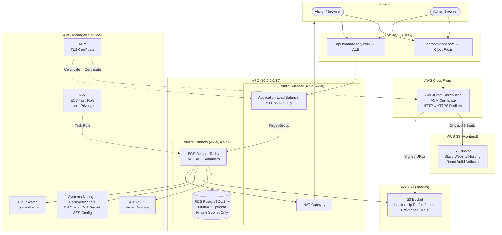

# Design Document: NNM Advisory Company Profile Website

## Overview

NNM Advisory is a professional services firm offering Accounting and IT services to businesses. This document describes the technical design for the public-facing company profile website and its supporting infrastructure.

The system consists of three primary runtime components:

- **Frontend**: A ReactJS single-page application (SPA) served statically via AWS CloudFront, presenting the public website and a protected Admin interface.
- **Backend API**: A .NET (C#) REST API deployed on AWS ECS Fargate, handling all data retrieval, form submissions, authentication, and content management.
- **Database**: A PostgreSQL database hosted on AWS RDS, persisting all application data in a private network.

Supporting services include AWS SES for email delivery, AWS S3 for image storage, AWS Systems Manager Parameter Store for secrets, and AWS CloudWatch for logging and monitoring. For local development, Docker Compose orchestrates all three components alongside a local PostgreSQL instance.

The design directly addresses all 15 requirements in the requirements specification, with particular emphasis on content management, form submission integrity, survey collection, admin security, and operational runbooks.

---

## Architecture

### AWS Architecture Overview

All production infrastructure runs within a single AWS region. The architecture separates public-facing concerns (CloudFront, ALB) from private concerns (ECS tasks, RDS) using a VPC with public and private subnets.



### Networking

| Layer | Resource | CIDR / Details |
|---|---|---|
| VPC | Main VPC | 10.0.0.0/16 |
| Public Subnet A | AZ-a | 10.0.1.0/24 — ALB, NAT Gateway |
| Public Subnet B | AZ-b | 10.0.2.0/24 — ALB (multi-AZ) |
| Private Subnet A | AZ-a | 10.0.11.0/24 — ECS tasks, RDS primary |
| Private Subnet B | AZ-b | 10.0.12.0/24 — ECS tasks, RDS standby |

**Security Groups:**

- `sg-alb`: Inbound TCP 443 from 0.0.0.0/0; outbound to `sg-ecs` on port 8080.
- `sg-ecs`: Inbound TCP 8080 from `sg-alb` only; outbound to `sg-rds` port 5432, and HTTPS 443 for AWS service endpoints (SES, SSM, S3, CloudWatch).
- `sg-rds`: Inbound TCP 5432 from `sg-ecs` only; no public inbound.

### Frontend Hosting (S3 + CloudFront)

The React app is built to static assets (`npm run build`) and uploaded to an S3 bucket with static website hosting enabled. The bucket policy denies all direct public access; all traffic is routed through a CloudFront Origin Access Control (OAC).

CloudFront is configured with:
- An ACM certificate for `nnmadvisory.com` and `www.nnmadvisory.com`.
- A viewer protocol policy of **Redirect HTTP to HTTPS**.
- A custom error response for 403/404 → returns `index.html` with HTTP 200, enabling React Router client-side navigation.
- Cache invalidations triggered on each frontend deployment.

### Backend API Hosting (ECS Fargate)

The .NET API is containerised using a multi-stage Docker build (`sdk` image for build, `aspnet` runtime image for deployment). The container image is pushed to Amazon ECR and referenced in an ECS task definition.

- **Service**: ECS Fargate service with a minimum of 1 task and auto-scaling based on CPU/memory.
- **Load Balancer**: An ALB listener on port 443 (ACM certificate for `api.nnmadvisory.com`) forwards to a target group pointing to ECS tasks on port 8080.
- **Health Check**: `GET /health` returns HTTP 200. ALB and ECS use this endpoint.
- The API enforces HTTPS-only at the ALB; plaintext HTTP connections to the ALB on port 80 are rejected (no HTTP listener configured).

### Database (RDS PostgreSQL)

- Engine: PostgreSQL 14+
- Instance class: `db.t3.medium` (adjustable)
- Deployed into the two private subnets; no public accessibility.
- Multi-AZ deployment optional (recommended for production).
- Storage: gp3 with auto-scaling enabled.
- Credentials stored in AWS Systems Manager Parameter Store (not in source code or build artifacts).

### Secrets Management (Parameter Store)

All sensitive configuration is stored as `SecureString` parameters in AWS Systems Manager Parameter Store:

| Parameter Name | Contents |
|---|---|
| `/nnm/db/connection-string` | Full PostgreSQL connection string |
| `/nnm/jwt/secret` | JWT signing secret (min 256-bit) |
| `/nnm/ses/sender-email` | Verified sender email address |
| `/nnm/ses/admin-email` | Company admin inbox address |
| `/nnm/s3/images-bucket` | S3 bucket name for image uploads |
| `/nnm/cors/allowed-origin` | Frontend origin URL |

The ECS task role grants `ssm:GetParameters` with a path-scoped policy on `/nnm/*`. Parameters are loaded at application startup via `AWS.Extensions.Configuration.SystemsManager`.

### Email Delivery (AWS SES)

AWS SES is used for all outbound email:
- Sender domain is verified in SES.
- Two email types: Acknowledgement Email to the client, Admin Notification Email to the company inbox.
- The ECS task role grants `ses:SendEmail` and `ses:SendRawEmail` scoped to the verified identity ARN.
- In local development, a configurable SMTP server (e.g., Mailhog or mailtrap) is used instead.

### Image / File Storage (S3)

A dedicated S3 bucket stores leadership profile photographs:
- Objects are **not publicly accessible** by default.
- The .NET API generates **pre-signed S3 URLs** (GET, valid 1 hour) when serving leadership profiles to the frontend, or CloudFront signed URLs if the image bucket is added as a CloudFront origin.
- On upload, the API validates file type (JPEG/PNG) and size (≤ 5 MB) before writing to S3.
- The ECS task role grants `s3:PutObject` and `s3:GetObject` scoped to the images bucket ARN.

### DNS (Route 53)

| Record | Type | Target |
|---|---|---|
| `nnmadvisory.com` | A (Alias) | CloudFront distribution |
| `www.nnmadvisory.com` | A (Alias) | CloudFront distribution |
| `api.nnmadvisory.com` | A (Alias) | Application Load Balancer |

### Monitoring (CloudWatch)

- ECS container logs stream to CloudWatch Logs via the `awslogs` log driver. Log group: `/nnm/api`.
- CloudWatch Alarms configured on:
  - ALB 5xx error rate > 1% over 5 minutes → SNS notification.
  - ECS CPU utilisation > 80% over 5 minutes → auto-scaling trigger.
  - RDS free storage < 20% → SNS notification.
- Structured JSON logging in the .NET API (using Serilog) ensures CloudWatch Insights can query log fields.

### IAM (Least Privilege)

The ECS task role (`nnm-api-task-role`) has an inline policy granting:

```json
{
  "Effect": "Allow",
  "Action": [
    "ssm:GetParameters",
    "ssm:GetParameter",
    "ssm:GetParametersByPath"
  ],
  "Resource": "arn:aws:ssm:*:*:parameter/nnm/*"
}
```

```json
{
  "Effect": "Allow",
  "Action": ["ses:SendEmail", "ses:SendRawEmail"],
  "Resource": "arn:aws:ses:*:*:identity/nnmadvisory.com"
}
```

```json
{
  "Effect": "Allow",
  "Action": ["s3:PutObject", "s3:GetObject"],
  "Resource": "arn:aws:s3:::nnm-advisory-images/*"
}
```

No IAM access keys are used; the task role is assumed automatically by the ECS runtime.

---

## Components and Interfaces

### Frontend (React SPA)

The React application is structured as a single-page application using React Router for client-side navigation. All pages are lazy-loaded to reduce initial bundle size.

**Pages and Routes:**

| Route | Component | Access |
|---|---|---|
| `/` | `HomePage` | Public |
| `/services` | `ServicesPage` | Public |
| `/about` | `AboutPage` | Public |
| `/surveys` | `SurveysPage` | Public |
| `/surveys/customer` | `CustomerSurveyPage` | Public |
| `/surveys/employee` | `EmployeeSurveyPage` | Public |
| `/contact` | `ContactPage` | Public |
| `/admin/login` | `AdminLoginPage` | Public |
| `/admin` | `AdminDashboardPage` | Protected (JWT required) |
| `*` | `NotFoundPage` | Public |

**Key Components:**

- `Navbar`: Persistent navigation bar. On viewports < 768px, renders a hamburger menu with collapsible drawer.
- `Footer`: Company name, copyright, social/contact link.
- `HeroSection`: Company name, tagline, CTA button.
- `ServiceBlock`: Renders a single service with title and description list.
- `LeadershipCard`: Photo (with fallback), name, title, biography.
- `ContactForm`: Controlled form with inline validation. On success, replaces itself with a `SuccessMessage`. On timeout (30 s), shows `TimeoutMessage`.
- `SurveyForm`: Shared base for both customer and employee surveys, supporting rating scales and open-ended fields.
- `AdminContentEditor`: Form for editing tagline, service blocks, and leadership profiles. Includes live preview panel.
- `ImageUploadField`: Handles photo upload with client-side type/size validation and preview display.
- `ProtectedRoute`: HOC that checks for a valid JWT in localStorage; redirects to `/admin/login` if absent or expired.

**State Management:**

React Context + `useReducer` is used for global state (auth token, content cache). No external state library is required given the scope. API calls use `fetch` wrapped in custom hooks (`useApi`, `useForm`).

**API Client:**

A thin `apiClient.ts` module wraps `fetch` with:
- Base URL from environment variable `REACT_APP_API_URL`.
- Authorization header injection for authenticated requests.
- 30-second request timeout using `AbortController`.
- Centralised error handling that maps HTTP status codes to user-facing messages.

### Backend API (.NET)

The .NET API follows a layered architecture:

```
Controllers → Services → Repositories → Database (EF Core)
                ↓
           External Services (SES, S3)
```

**Controllers:**

| Controller | Endpoints |
|---|---|
| `CompanyProfileController` | `GET /api/profile`, `GET /api/profile/services`, `GET /api/profile/leadership` |
| `ContactController` | `POST /api/contact` |
| `SurveyController` | `POST /api/surveys/customer`, `POST /api/surveys/employee` |
| `AuthController` | `POST /api/auth/login`, `POST /api/auth/logout` |
| `AdminController` | `PUT /api/admin/profile`, `PUT /api/admin/services/{id}`, `PUT /api/admin/leadership/{id}`, `POST /api/admin/leadership/{id}/photo` |
| `HealthController` | `GET /health` |

**Services:**

- `ICompanyProfileService` / `CompanyProfileService`: Reads and updates profile content, caching responses in memory with a 5-second TTL.
- `IContactService` / `ContactService`: Validates and persists contact submissions, triggers email sending.
- `ISurveyService` / `SurveyService`: Validates and persists customer and employee survey responses.
- `IAuthService` / `AuthService`: Validates credentials, enforces lockout policy, issues and validates JWTs.
- `IEmailService` / `AwsSesEmailService`: Sends acknowledgement and admin notification emails via AWS SES SDK.
- `IImageStorageService` / `S3ImageStorageService`: Uploads images to S3 after validation, generates pre-signed URLs for retrieval.

**Middleware Pipeline:**

1. HTTPS enforcement (reject plaintext at middleware level as a secondary guard behind ALB).
2. CORS middleware: allows only the configured frontend origin.
3. Request logging (Serilog structured logs to stdout → CloudWatch).
4. Global exception handler: catches unhandled exceptions, logs with UTC timestamp + request path, returns HTTP 500 with generic message.
5. Authentication middleware: validates JWT on protected endpoints.

**Configuration:**

`appsettings.json` holds non-sensitive defaults. On AWS, `AWS.Extensions.Configuration.SystemsManager` injects Parameter Store values at startup. Locally, `.env`-style values are loaded via `dotenv.net` or environment variable overrides in `docker-compose.yml`.

The application validates all required configuration at startup using `IOptions<T>` with data annotations; missing values cause a startup failure with a descriptive error message (Requirement 12.6).

### Email Service

```csharp
public interface IEmailService
{
    Task SendAcknowledgementEmailAsync(string toEmail, string clientName);
    Task SendAdminNotificationEmailAsync(ContactSubmission submission);
}
```

`AwsSesEmailService` implements this using the `AWSSDK.SimpleEmailV2` NuGet package. In local development, `SmtpEmailService` implements the same interface and connects to a local SMTP server (Mailhog).

### Image Storage Service

```csharp
public interface IImageStorageService
{
    Task<string> UploadImageAsync(IFormFile file, string key);
    Task<string> GetPresignedUrlAsync(string key, TimeSpan expiry);
}
```

`S3ImageStorageService` validates MIME type and file size before upload. Returns the S3 object key; the API generates a pre-signed URL per request for the frontend.

---

## Data Models

### PostgreSQL Schema

All tables use UUID primary keys generated by `gen_random_uuid()`. Timestamps are `TIMESTAMPTZ` stored in UTC.

#### `admin_users`

```sql
CREATE TABLE admin_users (
    id           UUID PRIMARY KEY DEFAULT gen_random_uuid(),
    username     VARCHAR(254) NOT NULL UNIQUE,
    password_hash TEXT NOT NULL,          -- bcrypt hash
    failed_login_attempts INT NOT NULL DEFAULT 0,
    locked_until TIMESTAMPTZ,
    created_at   TIMESTAMPTZ NOT NULL DEFAULT now(),
    updated_at   TIMESTAMPTZ NOT NULL DEFAULT now()
);
```

#### `company_content`

Stores key-value style configurable content (tagline, hero text).

```sql
CREATE TABLE company_content (
    id           UUID PRIMARY KEY DEFAULT gen_random_uuid(),
    content_key  VARCHAR(100) NOT NULL UNIQUE,  -- e.g. 'tagline', 'hero_cta_label'
    content_value TEXT NOT NULL,
    updated_at   TIMESTAMPTZ NOT NULL DEFAULT now()
);
```

#### `service_blocks`

```sql
CREATE TABLE service_blocks (
    id           UUID PRIMARY KEY DEFAULT gen_random_uuid(),
    category     VARCHAR(100) NOT NULL UNIQUE,  -- e.g. 'accounting', 'it', 'customer_survey', 'employee_survey'
    title        VARCHAR(100) NOT NULL,
    description  TEXT NOT NULL,
    offerings    TEXT[],                         -- array of offering strings
    display_order INT NOT NULL DEFAULT 0,
    updated_at   TIMESTAMPTZ NOT NULL DEFAULT now()
);
```

#### `leadership_profiles`

```sql
CREATE TABLE leadership_profiles (
    id           UUID PRIMARY KEY DEFAULT gen_random_uuid(),
    full_name    VARCHAR(100) NOT NULL,
    title        VARCHAR(100) NOT NULL,
    biography    TEXT NOT NULL CHECK (char_length(biography) <= 2000),
    photo_s3_key VARCHAR(500),
    display_order INT NOT NULL DEFAULT 0,
    updated_at   TIMESTAMPTZ NOT NULL DEFAULT now()
);
```

#### `contact_submissions`

```sql
CREATE TABLE contact_submissions (
    id           UUID PRIMARY KEY DEFAULT gen_random_uuid(),
    full_name    VARCHAR(100) NOT NULL,
    email        VARCHAR(254) NOT NULL,
    subject      VARCHAR(150) NOT NULL,
    message      TEXT NOT NULL CHECK (char_length(message) BETWEEN 10 AND 2000),
    submitted_at TIMESTAMPTZ NOT NULL DEFAULT now()
);
```

#### `customer_survey_responses`

```sql
CREATE TABLE customer_survey_responses (
    id                   UUID PRIMARY KEY DEFAULT gen_random_uuid(),
    service_satisfaction SMALLINT NOT NULL CHECK (service_satisfaction BETWEEN 1 AND 5),
    nps_score            SMALLINT NOT NULL CHECK (nps_score BETWEEN 0 AND 10),
    open_feedback        TEXT CHECK (char_length(open_feedback) <= 1000),
    submitted_at         TIMESTAMPTZ NOT NULL DEFAULT now()
);
```

#### `employee_survey_responses`

```sql
CREATE TABLE employee_survey_responses (
    id                     UUID PRIMARY KEY DEFAULT gen_random_uuid(),
    engagement_score       SMALLINT NOT NULL,
    workplace_satisfaction TEXT NOT NULL,
    open_feedback          TEXT,
    submitted_at           TIMESTAMPTZ NOT NULL DEFAULT now()
    -- No PII fields; no name, email, or employee ID columns
);
```

#### Migration Strategy

Database schema is managed using **EF Core Migrations** (code-first). Each migration is a numbered C# class generated by `dotnet ef migrations add`. Applying all migrations to an empty database (`dotnet ef database update`) produces the complete schema.

For AWS RDS, migrations are applied as part of the deployment pipeline before the new ECS task version is promoted to active. A separate ECS task definition running `dotnet ef database update` executes as a one-off task; the deployment pipeline waits for it to complete successfully before routing traffic to the new API version.

### Entity Framework Core Models

```csharp
public class LeadershipProfile
{
    public Guid Id { get; set; }
    public string FullName { get; set; } = string.Empty;   // max 100 chars
    public string Title { get; set; } = string.Empty;      // max 100 chars
    public string Biography { get; set; } = string.Empty;  // max 2000 chars
    public string? PhotoS3Key { get; set; }
    public int DisplayOrder { get; set; }
    public DateTimeOffset UpdatedAt { get; set; }
}

public class ContactSubmission
{
    public Guid Id { get; set; }
    public string FullName { get; set; } = string.Empty;   // max 100 chars
    public string Email { get; set; } = string.Empty;      // max 254 chars
    public string Subject { get; set; } = string.Empty;    // max 150 chars
    public string Message { get; set; } = string.Empty;    // 10-2000 chars
    public DateTimeOffset SubmittedAt { get; set; }
}

public class CustomerSurveyResponse
{
    public Guid Id { get; set; }
    public int ServiceSatisfaction { get; set; }   // 1-5
    public int NpsScore { get; set; }              // 0-10
    public string? OpenFeedback { get; set; }      // max 1000 chars
    public DateTimeOffset SubmittedAt { get; set; }
}

public class AdminUser
{
    public Guid Id { get; set; }
    public string Username { get; set; } = string.Empty;
    public string PasswordHash { get; set; } = string.Empty;  // bcrypt
    public int FailedLoginAttempts { get; set; }
    public DateTimeOffset? LockedUntil { get; set; }
    public DateTimeOffset CreatedAt { get; set; }
    public DateTimeOffset UpdatedAt { get; set; }
}
```

### JWT Token Model

```json
{
  "sub": "admin-user-uuid",
  "username": "admin",
  "iat": 1700000000,
  "exp": 1700003600,
  "jti": "unique-token-id"
}
```

- Signed with HS256 using the secret from Parameter Store.
- Expiry: 60 minutes from issuance (Requirement 8.6).
- Inactivity timeout enforced by the frontend: any API activity resets a local 60-minute timer; on expiry, the frontend clears the token and redirects to `/admin/login`.

### API Request/Response Shapes

**POST /api/contact**

```json
// Request
{
  "fullName": "Jane Smith",
  "email": "jane@example.com",
  "subject": "Service Enquiry",
  "message": "I would like to know more about your accounting services."
}

// Success Response (202 Accepted)
{ "message": "Your message has been received. We will be in touch shortly." }

// Validation Error Response (422 Unprocessable Entity)
{
  "errors": {
    "email": ["The Email field is not a valid email address."],
    "message": ["The Message field must be between 10 and 2000 characters."]
  }
}
```

**POST /api/auth/login**

```json
// Request
{ "username": "admin", "password": "secret" }

// Success Response (200 OK)
{ "token": "eyJhbGci..." }

// Auth Failure Response (401 Unauthorized)
{ "error": "Invalid credentials." }

// Locked Response (429 Too Many Requests)
{ "error": "Account locked. Try again after 2024-01-01T12:15:00Z." }
```

### Local Development Configuration

**`docker-compose.yml` (top-level structure):**

```yaml
services:
  frontend:
    build: ./frontend
    ports: ["3000:3000"]
    environment:
      - REACT_APP_API_URL=http://localhost:5000
    volumes: ["./frontend:/app"]

  api:
    build: ./api
    ports: ["5000:8080"]
    env_file: ./api/.env
    depends_on: [db]

  db:
    image: postgres:16
    ports: ["5432:5432"]
    environment:
      POSTGRES_USER: nnm
      POSTGRES_PASSWORD: devpassword
      POSTGRES_DB: nnmdb
    volumes: ["pgdata:/var/lib/postgresql/data"]

volumes:
  pgdata:
```

**`api/.env.sample`** (committed to repo, no real values):

```
DB_CONNECTION_STRING=Host=db;Port=5432;Database=nnmdb;Username=nnm;Password=devpassword
JWT_SECRET=replace-with-a-strong-random-secret-min-32-chars
EMAIL_PROVIDER=smtp
SMTP_HOST=mailhog
SMTP_PORT=1025
SENDER_EMAIL=noreply@nnmadvisory.local
ADMIN_EMAIL=admin@nnmadvisory.local
S3_IMAGES_BUCKET=nnm-local-images
IMAGE_STORAGE_PROVIDER=local
CORS_ALLOWED_ORIGIN=http://localhost:3000
```

The actual `api/.env` file with real values is listed in `.gitignore`.

---

## Correctness Properties

*A property is a characteristic or behavior that should hold true across all valid executions of a system — essentially, a formal statement about what the system should do. Properties serve as the bridge between human-readable specifications and machine-verifiable correctness guarantees.*

### Property 1: Contact Form Validation Rejects Structurally Invalid Inputs

*For any* contact form submission where one or more fields are empty, exceed their character limits, or the email address does not conform to the `local-part@domain.tld` format, the API SHALL reject the submission with an HTTP 422 response and the response SHALL identify each invalid field by name, leaving the database unchanged.

**Validates: Requirements 5.6, 5.7, 10.4**

---

### Property 2: Contact Submission Persistence Round-Trip

*For any* valid contact form submission (full name ≤ 100 chars, valid email, subject ≤ 150 chars, message 10–2000 chars), after the API returns a success response, querying the database for that submission SHALL return a record with identical field values and a UTC timestamp recording the moment of submission.

**Validates: Requirements 5.2, 11.6**

---

### Property 3: Admin Authentication Lockout Invariant

*For any* sequence of 5 or more consecutive failed login attempts for the same username, the API SHALL return an account-locked response for all subsequent login attempts within the 15-minute lockout window, regardless of whether the subsequent attempt uses correct or incorrect credentials.

**Validates: Requirements 8.5**

---

### Property 4: Biography Length Validation

*For any* biography update where the input string exceeds 2000 characters or consists entirely of whitespace, the API SHALL return an error response and the database record for that leadership profile SHALL retain its previously stored biography value unchanged.

**Validates: Requirements 4.7, 4.8**

---

### Property 5: Profile Photo Upload Type and Size Rejection

*For any* file upload where the MIME type is not `image/jpeg` or `image/png`, or the file size exceeds 5 MB, the API SHALL reject the upload and return an error response indicating the reason, and no new object SHALL be written to the S3 images bucket.

**Validates: Requirements 4.5, 4.6, 9.3, 9.4, 9.5**

---

### Property 6: Survey Validation Rejects Incomplete Submissions

*For any* customer survey submission where the service satisfaction score is outside [1, 5] or the NPS score is outside [0, 10], or any required question is absent, the API SHALL return an HTTP 422 response and SHALL NOT persist the submission to the database.

**Validates: Requirements 6.4, 7.4**

---

### Property 7: Survey Timestamp Invariant

*For any* successfully submitted survey response (customer or employee), the `submitted_at` timestamp stored in the database SHALL be a valid UTC timestamp that falls within a 5-second window of when the API received the request.

**Validates: Requirements 6.3, 7.3, 11.6**

---

### Property 8: Admin Content Update Reflected in Subsequent Reads

*For any* valid content update submitted by an authenticated admin (tagline, service block, biography), after the API returns a success response, all subsequent `GET` requests to the corresponding profile endpoint SHALL return the updated value, not the previously stored value.

**Validates: Requirements 2.4, 3.6, 9.2**

---

### Property 9: CORS Policy Rejects Non-Configured Origins

*For any* cross-origin request where the `Origin` header does not exactly match the configured frontend origin, the API SHALL return an HTTP 403 response and SHALL NOT process the request body.

**Validates: Requirements 10.5**

---

### Property 10: SQL Injection Safety

*For any* input string containing SQL metacharacters (e.g., `'`, `--`, `;`, `DROP TABLE`), when that string is submitted as a form field value, the API SHALL process the string as literal data (storing or rejecting it based on other validation rules) and SHALL NOT execute the embedded SQL fragments against the database.

**Validates: Requirements 11.3**

---

### Property 11: Employee Survey Anonymity Invariant

*For any* employee survey submission, the stored database record SHALL contain no fields that identify the respondent — specifically, no name, email address, or employee ID — regardless of what the submission payload contains.

**Validates: Requirements 7.6**

---

## Error Handling

### Frontend Error Handling

| Scenario | Behaviour |
|---|---|
| API returns 4xx validation error | Display inline error messages adjacent to the offending field(s); do not clear other fields |
| API returns 5xx server error | Display a generic "Something went wrong, please try again later" banner |
| Contact form: no API response within 30 s | Display timeout message; preserve all form field values |
| Contact form: success | Replace form with confirmation message |
| Logo image unavailable | Display text "NNM Advisory" as fallback (React `onError` handler on ``) |
| Backend unavailable on Services load | Display last cached service block content from localStorage; never show empty blocks |
| Admin: 401 on protected endpoint | Clear token, redirect to `/admin/login` |
| Admin: biography > 2000 chars | Show live character counter turning red; disable save button |

### Backend API Error Handling

| Scenario | HTTP Status | Response Body |
|---|---|---|
| Missing required fields | 422 | `{ "errors": { "fieldName": ["message"] } }` |
| Malformed JSON body | 400 | `{ "error": "Invalid JSON at line X, column Y." }` |
| Invalid credentials | 401 | `{ "error": "Invalid credentials." }` |
| Account locked | 429 | `{ "error": "Account locked. Try again after <ISO timestamp>." }` |
| Unauthorised admin action | 403 | `{ "error": "Access denied." }` |
| Database constraint violation | 500 | `{ "error": "The operation could not be completed." }` (details logged internally) |
| Database write failure | 500 | Full transaction rollback; `{ "error": "The operation could not be completed." }` |
| File type/size violation | 400 | `{ "error": "File must be JPEG or PNG and no larger than 5 MB." }` |
| Unhandled exception | 500 | `{ "error": "An unexpected error occurred." }` (full details logged to CloudWatch with UTC timestamp and request path) |
| Log store unavailable | N/A | API continues processing; logs written to local fallback file |

### Database Error Handling

- All write operations execute within a database transaction (EF Core `DbContext.SaveChangesAsync` wraps all changes in a transaction by default).
- On any constraint violation, EF Core throws `DbUpdateException`; the service layer catches this, rolls back the transaction, and re-throws a domain exception that the controller maps to an HTTP 500 response.
- No partial writes are possible for multi-step operations (e.g., contact submission + email); if the email send fails, the submission remains persisted (email is a best-effort secondary action) and the API still returns success to the client.

---

## Testing Strategy

### Unit Tests

The .NET API uses **xUnit** with **Moq** for mocking. React components use **Vitest** with **React Testing Library**.

Targeted unit test coverage:

- `AuthService`: correct credential validation, lockout counter increment, lockout release after 15 minutes, JWT issuance with correct claims, JWT expiry.
- `ContactService`: validation rules for each field (length limits, email format), duplicate submission prevention.
- `SurveyService`: score range validation for customer survey, anonymity enforcement for employee survey (no PII fields written).
- `S3ImageStorageService`: MIME type rejection, size rejection, successful upload path.
- `AwsSesEmailService`: acknowledgement email template contains client name, admin notification email contains all four required fields.
- React `ContactForm`: inline error display on empty fields, form not submitted on invalid email, confirmation message shown on success, field values preserved on error.
- React `ProtectedRoute`: redirects to login when no token present, renders children when valid token present.
- React `AdminContentEditor`: live preview updates within 1 second of input change.

### Property-Based Tests

The API uses **CsCheck** (C# property-based testing library) to validate universal properties. The React frontend uses **fast-check** for front-end properties.

Each property test runs a minimum of **100 iterations** per execution.

**Backend Property Tests (CsCheck):**

| Property | Generator | Assertion |
|---|---|---|
| Property 1: Contact Validation | `Gen.String` with lengths outside [1, 100/150/2000] and malformed emails | API returns 422; database row count unchanged |
| Property 2: Contact Round-Trip | `Gen.String` constrained to valid lengths + `Gen.String` matching `\S+@\S+\.\S+` | Stored record fields equal submitted values |
| Property 3: Auth Lockout | `Gen.Int` (5–50 failed attempts), `Gen.String` (passwords) | After N ≥ 5 failures, all subsequent attempts (correct or not) within 15 min return locked response |
| Property 4: Biography Validation | `Gen.String` > 2000 chars and whitespace-only strings | API returns error; DB biography unchanged |
| Property 5: File Upload Rejection | `Gen.Byte[]` with non-JPEG/PNG MIME or size > 5 MB | API returns 400; S3 bucket object count unchanged |
| Property 6: Survey Validation | `Gen.Int` outside [1,5] for satisfaction, outside [0,10] for NPS | API returns 422; survey row count unchanged |
| Property 7: Survey Timestamp | `Gen.String` (valid survey payloads) | `submitted_at` within 5-second window of API receipt |
| Property 9: CORS Rejection | `Gen.String` (random Origin headers ≠ configured origin) | API returns 403 for all non-matching origins |
| Property 10: SQL Safety | `Gen.String` with SQL metacharacters injected into form fields | Field stored as literal string; no SQL error; DB integrity intact |
| Property 11: Employee Anonymity | `Gen.String` payloads including name/email/id fields | Stored record contains no PII fields |

**Frontend Property Tests (fast-check):**

| Property | Generator | Assertion |
|---|---|---|
| Property 8: Content Update Reflection | Arbitrary valid content strings | GET endpoint after PUT returns the new value |
| Property 6 (client-side): Survey incomplete | Arbitrary missing required fields | Form does not call API; inline errors displayed for each missing field |

**Tag format for each property test:**

```
// Feature: nnm-advisory-website, Property 1: Contact form validation rejects structurally invalid inputs
```

### Integration Tests

Integration tests run against a real PostgreSQL instance (via Testcontainers for .NET) and verify end-to-end flows:

- Full contact form submission: POST → database row exists → acknowledgement email sent (mocked SES).
- Admin login flow: valid credentials → JWT returned → protected endpoint accessible → invalid credentials → 401.
- Service block update: PUT → GET returns updated content within 5 seconds.
- Leadership profile photo upload: POST with valid JPEG → S3 PutObject called → GET returns pre-signed URL.
- Database migration: applying all EF Core migrations to an empty database produces the expected schema with no errors.

### End-to-End Tests

**Playwright** is used for browser-level E2E tests against the full Docker Compose stack:

- Visitor can navigate all sections without full page reload.
- Contact form shows inline errors on invalid input; shows confirmation on valid submission.
- 404 page rendered for unknown routes with link back to home.
- Collapsible menu appears on mobile viewport (320px width).
- Admin login: valid credentials → admin dashboard; invalid → error message; 5 failed attempts → lockout message.
- Admin updates tagline → public home page reflects update within 5 seconds.
